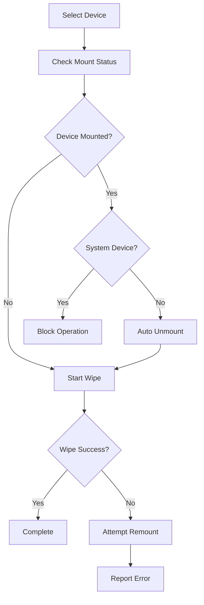

# 🔓 Automatic Device Unmounting Feature

The SecureWipe tool now includes **automatic device unmounting** functionality that eliminates the need to manually unmount drives before wiping them.

## ✨ Key Features

### 🤖 **Automatic Unmounting**
- Automatically detects and unmounts all partitions on the target device
- Works on both **Linux** and **Windows** systems
- Graceful unmounting with fallback to force unmount if needed
- Smart detection of critical system partitions

### 🛡️ **Safety Features**
- **System Drive Protection**: Automatically prevents unmounting of critical system drives
- **Critical Partition Detection**: Identifies and protects system-critical mount points
- **Process Management**: Can force-kill processes blocking unmount operations
- **Rollback Support**: Attempts to remount devices if wiping fails

### 🎯 **Smart Detection**
- Detects mount points using `lsblk` (Linux) and PowerShell (Windows)
- Identifies file system types and mount relationships
- Shows detailed mounting status in the GUI

## 🚀 How to Use

### 🖥️ **GUI Mode (Recommended)**
1. Launch the GUI: `python3 run_gui.py`
2. Select your target device
3. ✅ **Enable "🔓 Automatically unmount device before wiping"** (enabled by default)
4. Choose your wiping method
5. Click **"🔥 START SECURE WIPE"**
6. The software will automatically:
   - Check if the device is mounted
   - Unmount all partitions safely
   - Perform the secure wipe
   - Show progress for both unmounting and wiping

### 💻 **Command Line Mode**
```bash
# Automatic unmounting is enabled by default
python3 main.py --device /dev/sdb --method nist

# To disable automatic unmounting, modify the code or use GUI
```

## 📊 **GUI Status Display**

The GUI now shows detailed mounting information:

```
MOUNTING STATUS:
━━━━━━━━━━━━━━━━━━━━━━━━━━━━━━━━━━━━━━━━━━━━━━━━━━━━━━━━━━━━━━━━━━━━━━━━━━━━━━━━
Device Status: ⚠️ Has 2 mounted partition(s)
Mounted Partitions:
  • /dev/sdb1 → /media/user/USB1 (vfat)
  • /dev/sdb2 → /media/user/DATA (ext4)
Ready to Wipe: ✅ Yes (Can auto-unmount partitions)
```

## 🔧 **Technical Details**

### **Linux Implementation**
- Uses `lsblk` to detect mounted partitions
- Attempts graceful unmount with `umount`
- Falls back to lazy unmount (`umount -l`) if needed
- Final fallback to force unmount (`umount -f`)

### **Windows Implementation**
- Uses PowerShell and WMI to detect mounted drives
- Uses `diskpart` to remove drive letters and access paths
- Handles both basic and dynamic disks

### **Safety Mechanisms**
```python
# Critical mount points that are protected:
Linux: ['/', '/boot', '/boot/efi', '/usr', '/var', '/home']
Windows: ['C:', 'C:\\']
```

## ⚠️ **Important Safety Notes**

### 🚫 **What's Protected**
- **System drives** (C: on Windows, / on Linux)
- **Boot partitions** (/boot, /boot/efi)
- **Critical system directories** (/usr, /var, /home)

### ✅ **What Can Be Unmounted**
- External USB drives
- Secondary internal drives
- Data partitions
- Network-attached storage
- Removable media

### 🔥 **Process Handling**
If processes are blocking unmount:
1. First tries graceful termination
2. Waits 5 seconds for clean shutdown
3. Force kills if necessary
4. Reports killed processes in logs

## 🧪 **Testing the Feature**

```bash
# Test the unmounting functionality
python3 test_unmounting.py

# Test with GUI
python3 run_gui.py

# Create test files for safe testing
python3 -c "
from gui.interface import SecureWiperGUI
app = SecureWiperGUI()
app.create_test_files()
"
```

## 📋 **Error Handling**

The system handles various error conditions:

- **Permission denied**: Shows clear error message about admin/root requirements
- **Device busy**: Attempts to kill blocking processes
- **System device**: Prevents dangerous operations
- **Unmount failure**: Provides detailed error information
- **Wipe failure**: Attempts to remount the device to restore original state

## 🎯 **Benefits**

1. **User-Friendly**: No more manual unmounting required
2. **Safe**: Comprehensive protection against accidental system damage
3. **Reliable**: Multiple fallback mechanisms for stubborn mounts
4. **Informative**: Clear status display and error messages
5. **Cross-Platform**: Works on both Linux and Windows

## 🔄 **Workflow**



This feature makes secure wiping much more convenient while maintaining the highest safety standards! 🎉